# CarbonReady — AI Carbon Compliance Copilot for MSME Exporters

> **Turning Vernacular Shopfloor Logs into Audited EU CBAM Dossiers for Indian MSME Exporters.**  
> **Competition:** PCCOE International Grand Challenge 2026 — INDRADHANU  
> **Theme:** AI for Climate Change  
> **Target Scenario:** Indian Iron & Steel MSME Mini-Mills exporting to the European Union under EU CBAM (Regulations 2023/1773 & 2025/2547)

---

## A. Project Introduction

Starting in 2026, the European Union's **Carbon Border Adjustment Mechanism (CBAM)** imposes carbon tariffs (pegged to EU ETS prices of ~€85/tCO2e) on energy-intensive goods entering the European single market. Indian secondary steel manufacturers—operating Electric Arc Furnaces (EAF) and induction melting shops in industrial clusters like Ludhiana, Mandi Gobindgarh, and Jalna—face an existential trade crisis. 

If an exporter cannot supply verified, installation-specific emissions telemetry, European customs authorities apply a punitive default fallback benchmark of **2.15 tCO2e per metric tonne of steel**, triggering over **€142,500 in border tax penalties per 1,000 tonnes of exported steel**.

**CarbonReady** is an enterprise AI copilot specifically engineered for Indian MSME manufacturing exporters. It allows shopfloor supervisors to record daily furnace and fuel logs in their native language (Hindi, Marathi, or English), uses a specialized **Nugen domain-aligned AI model** (`cbam-iron-steel-v1`) to extract structured physical metrics, and runs a **100% deterministic EN 19694-2 Method C carbon balance**. In seconds, CarbonReady generates an audited Draft Supplier Emissions Report, a CIRPASS-compliant Digital Product Passport, and a defensible tariff shield.

---

## B. Problem Statement

1. **Shopfloor Data Collection Barriers:** Furnace shift logs in secondary mini-mills are kept in physical logbooks or communicated verbally in vernacular languages (Hindi, Marathi, Punjabi) mixing units (metric tonnes, quintals, heats, electricity sub-meter units).
2. **Mathematical & Scientific Complexity:** Calculating embedded carbon under European regulations requires complex stoichiometric combustion math (Scope 1 direct) and regional grid emission factors (Scope 2 indirect) that ordinary factory accountants cannot navigate.
3. **Severe Financial CBAM Penalties:** Accepting default punitive EU benchmark values (2.15 tCO2e/MT) wipes out the entire profit margin of Indian steel exporters.
4. **Prohibitive Compliance Costs:** Small mills cannot afford €30,000 European sustainability consulting firms or heavy SAP/Salesforce carbon software.
5. **Absence of Accessible Metrology Tools:** Existing software assumes English-speaking sustainability teams with automated IoT sensors, failing the reality of Indian MSME shopfloors.

---

## C. Our Solution

CarbonReady provides an intuitive, end-to-end compliance workflow designed for shopfloor reality:

- **Voice-First Vernacular Ingestion:** Shift supervisors speak naturally in Hindi, Marathi, or Indian English describing furnace heats, scrap charges, and sub-meter readings.
- **Verbatim Speech Transcription:** Integrated with **Google Gemini 3.5 Transcribe** to return faithful Devanagari/English transcripts without summarization or calculation errors.
- **Domain-Aligned Extraction:** The deployed **Nugen Aligned Model** (`model_01m6tqnx1n5br0ca`) extracts structured metallurgical entities with Zod schema validation and zero-hallucination missing field isolation.
- **Deterministic Metrology Engine:** All numerical calculations follow **EN 19694-2 Method C** and the Central Electricity Authority (CEA v20.0) national grid baseline (**0.716 kgCO2e/kWh**). Zero AI hallucination in numerical arithmetic.
- **Customs-Ready Documentation:** Instant generation of official 15-section Draft Supplier Emissions Declarations (PDF), DG TAXUD XML v2.4 dossiers, and CIRPASS Digital Product Passports.
- **Actionable Decarbonization:** Interactive What-If simulator (Solar PPA open access, scrap preheating) connected to verified Indian government subsidies (BEE PAT, Ministry of Steel).

---

## D. Key Features & Implementation Status

### Core Implemented Capabilities (Tested & Fully Functional)
- **Multilingual Voice Intake (`/assistant`):** Real-time browser audio recording, audio file upload, and pre-recorded shift WAV fixtures in Hindi, Marathi, and English.
- **Nugen Domain AI Extraction (`/api/ai/extract`):** Live server-side extraction using deployed aligned model `model_01m6tqnx1n5br0ca` (`cbam-iron-steel-v1`).
- **Deterministic Calculation Engine (`/calc-engine`):** EN 19694-2 Method C mass balance with CEA v20.0 grid factor and SHA-256 cryptographic audit seal.
- **Executive Command Dashboard (`/dashboard`):** Real-time carbon intensity KPI (1.42 tCO2e/MT), €142,500 tariff shield, and live batch context ribbon.
- **Decarbonization Planner (`/planner`):** Real-time What-If MACC sliders (Solar PPA 0–50%, scrap preheating) with dynamic CAPEX/OPEX payback modeling.
- **CBAM Report Centre (`/reports`):** Regulation (EU) 2025/2547 compliant dossier, real downloadable multi-page print-ready PDF, and DG TAXUD XML export.
- **Consignment & Audit Ledger (`/audit-history`):** Immutable historical log displaying user-generated filings with "Active Filing" badges and cryptographic proofs.
- **Digital Product Passport (`/passport`):** CIRPASS JSON-LD aligned passport for crude steel (CN 7207), scannable QR code, 91.2% recycled scrap circularity, and trust badge.
- **Customs Export Paperwork (`/export-paperwork`):** Pre-filled Commercial Invoice Carbon Annex synchronized with active plant telemetry.
- **Manufacturer Onboarding (`/onboarding`):** Setup plant profile, UDYAM registration, UN/LOCODE, and target European discharge ports.
- **Government Scheme Matcher (`/schemes`):** Verified Indian green steel subsidies (BEE PAT, Ministry of Steel, IREDA).

### Prototype & Extension Interfaces
- **Accredited Verifier Marketplace (`/verification`):** Representative profiles of accredited verification bodies (TÜV, DNV, BV) with pre-audit dossier dispatch.
- **Upstream Supplier Portal (`/suppliers`):** Scope 3 precursor tracking for sponge iron DRI and ferro-alloys with missing document alerts.
- **Cluster Group Buying (`/group-buying`):** Consortium purchasing coordination for scrap pooling and renewable power.
- **Regional Benchmarks (`/benchmarks`):** Anonymous peer ranking across Punjab, Maharashtra, and Odisha clusters.
- **Compliance Hub (`/compliance`):** Regulation Radar tracking CBAM, ESPR, CCTS, and BRSR Core requirements.

---

## E. How CarbonReady Works

```mermaid
flowchart LR
    A["1. Manufacturer Voice / Text<br/>(Hindi, Marathi, English)"] --> B["2. Gemini 3.5 Transcribe<br/>(Verbatim Speech-to-Text)"]
    B --> C["3. Supervisor Review<br/>(Editable Native Transcript)"]
    C --> D["4. Nugen Aligned Model<br/>(model_01m6tqnx1n5br0ca)"]
    D --> E["5. Data Confirmation Gate<br/>(Missing Fields Preserved)"]
    E --> F["6. Deterministic Engine<br/>(EN 19694-2 Method C | CEA v20.0)"]
    F --> G["7. Executive Dashboard<br/>(Intensity 1.42 t | Shield €142.5k)"]
    G --> H["8. Decarbonization Planner<br/>(Solar PPA What-If Simulation)"]
    H --> I["9. Draft CBAM Dossier<br/>(Print-Ready PDF + XML v2.4)"]
    I --> J["10. Passport & Customs Paperwork<br/>(CIRPASS QR + Commercial Annex)"]
```



---

## F. Technology Stack

- **Framework & Runtime:** Next.js 15.5.29 (App Router) | Node.js 18+ (tested on `v26.13.0`)
- **Frontend Core:** React 19.0.0 | TypeScript 5.7.3
- **Styling & Theme:** Tailwind CSS 3.4.17 (Custom Stitch Dark Industrial Enterprise theme) | PostCSS 8.5.2
- **Motion & Micro-interactions:** Motion 14.10.1 (Framer Motion successor) with reduced-motion accessibility rules
- **AI Domain Extraction:** Nugen AI Cloud (`https://api.nugen.ai/v1`) | Aligned Model: `model_01m6tqnx1n5br0ca` (`cbam-iron-steel-v1`)
- **Speech-to-Text:** Google Gemini 3.5 Transcribe (`gemini-3.5-transcribe` via Google GenAI REST API)
- **Data Validation:** Zod 3.24.2 for runtime schema enforcement
- **Testing Harness:** Vitest 3.2.7 (49 unit and integration tests)
- **Iconography:** Google Material Symbols & Lucide React 0.475.0
- **Deployment Platform:** Vercel (Edge / Serverless Node.js Runtime)

---

## G. Project Architecture & Directory Layout

```text
stitch_carbonready_msme_climate_intelligence_copilot/
├── public/
│   ├── audio/samples/           # 16-bit mono 16kHz PCM audio test fixtures (HI/MR/EN)
│   └── icons/                   # Material symbols & application icons
├── src/
│   ├── app/                     # Next.js 15 App Router pages & server Route Handlers
│   │   ├── api/ai/extract/      # Server Route: Nugen Aligned AI extraction
│   │   ├── api/ai/transcribe/   # Server Route: Gemini 3.5 Transcribe audio STT
│   │   ├── api/calculate/       # Server Route: Deterministic CBAM calculation
│   │   ├── assistant/           # Multilingual Voice Assistant & shift log intake
│   │   ├── audit-history/       # Consignment ledger with SHA-256 audit proofs
│   │   ├── benchmarks/          # Regional cluster benchmarking (Ludhiana/Jalna)
│   │   ├── calc-engine/         # Carbon Intelligence & metallurgical anomalies
│   │   ├── compliance/          # Multi-regulation matrix & CCTS tracker
│   │   ├── dashboard/           # Executive command dashboard & tariff shields
│   │   ├── export-paperwork/    # Customs Annex & Commercial Invoice auto-fill
│   │   ├── group-buying/        # Scrap & solar open-access consortium buying
│   │   ├── onboarding/          # Manufacturer plant profile & UDYAM registration
│   │   ├── passport/            # CIRPASS Digital Product Passport & Trust Badge
│   │   ├── planner/             # Decarbonization What-If MACC simulator
│   │   ├── reports/             # CBAM Report Centre (PDF & XML dossier generation)
│   │   ├── schemes/             # Indian government subsidies & grant matcher
│   │   ├── suppliers/           # Upstream Scope 3 precursor supplier portal
│   │   ├── verification/        # Accredited auditor marketplace (TÜV, DNV, BV)
│   │   ├── globals.css          # Tailwind CSS with @media print & reduced-motion rules
│   │   ├── layout.tsx           # Global root layout with theme provider
│   │   └── page.tsx             # Executive landing page
│   ├── components/              # Modular UI components
│   │   ├── shell/               # AppShell, SidebarNavigation, TopComplianceBar
│   │   └── ui/                  # AnimatedCounter, Badge, StatCard
│   ├── lib/                     # Core business logic & SDK adapters
│   │   ├── ai/                  # Nugen client, Gemini transcriber, prompt templates
│   │   ├── data/                # Initial plant profiles, demo state, storage helpers
│   │   └── engine/              # CBAM calculator, emission factors, CEA baselines
│   ├── test/                    # Vitest automated test suites (49 passing tests)
│   └── types/                   # TypeScript schemas for plant data & emissions
├── docs/                        # Architecture guides and project status
│   ├── ARCHITECTURE.md          # Complete system architecture & dataflow diagrams
│   └── PROJECT_STATUS.md        # Feature verification matrix & empirical test log
├── scripts/                     # Next.js platform launcher & audio generator
├── supabase/migrations/         # Optional PostgreSQL DDL schemas with RLS
├── CONTRIBUTING.md               # Developer setup, branching & PR conventions
├── SECURITY.md                   # Security policy & credential protection protocol
├── .env.example                 # Safe environment configuration template
├── .gitignore                   # Comprehensive Git exclusion rules
├── next.config.ts               # Next.js build configuration with platform optimizations
├── package.json                 # Project dependencies and script definitions
├── tailwind.config.ts           # Stitch dark industrial enterprise styling tokens
└── tsconfig.json                # TypeScript compiler configuration
```

### Key Documentation & Repository Guides

- 📐 [**System Architecture (`docs/ARCHITECTURE.md`)**](docs/ARCHITECTURE.md) — Comprehensive technical architecture, data flow diagrams, security boundaries, and component breakdown.
- 📊 [**Feature Implementation & Test Status (`docs/PROJECT_STATUS.md`)**](docs/PROJECT_STATUS.md) — Feature verification status matrix, empirical Vitest test logs (49/49 passing), and Next.js route builds.
- 🤝 [**Contributing Guide (`CONTRIBUTING.md`)**](CONTRIBUTING.md) — Local setup steps, branch naming standards, commit message conventions, and PR workflow.
- 🔒 [**Security Policy (`SECURITY.md`)**](SECURITY.md) — Credential protection rules, zero-leak isolation, and vulnerability disclosure protocol.
- 🎬 [**Live Demo Protocol (`CARBONREADY_DEMO_GUIDE.md`)**](CARBONREADY_DEMO_GUIDE.md) — Step-by-step walkthrough for live evaluation and hackathon presentations.
- 🎙️ [**Judge Demo Script (`CARBONREADY_JUDGE_DEMO_SCRIPT.md`)**](CARBONREADY_JUDGE_DEMO_SCRIPT.md) — Timed 5-minute presentation talk track and live voice testing sequence.

---

## H. Screenshots & UI Progressions

The user interface follows the dark forest-green enterprise theme approved for the Stitch Climate Intelligence platform:

- **Landing Page (`/`):** Real-time regulatory countdown timer, value proposition, and quick-launch action tiles.
- **Voice Metrology Assistant (`/assistant`):** Vernacular language tabs, real-time microphone recorder, editable verbatim transcript, and Nugen domain extraction card.
- **Executive Command Dashboard (`/dashboard`):** Specific carbon intensity KPI card (1.42 tCO2e/MT), CBAM tariff shield (€142,500/1k MT), and historical compression curve.
- **Decarbonization Planner (`/planner`):** Real-time What-If MACC simulation sliders (Solar PPA open access, scrap preheating).
- **CBAM Report Centre (`/reports`):** 15-Section official dossier viewer, DG TAXUD XML exporter, and 2-page print-ready PDF generator.
- **Digital Product Passport (`/passport`):** Scannable CIRPASS QR code and embeddable trust badge displaying 91.2% circular scrap ratio.

---

## I. Installation & Local Setup

### Prerequisites
- **Node.js:** `v18.18.0` or higher (Tested on `v26.13.0`)
- **Package Manager:** `npm` (v9+) or `pnpm`
- **OS:** Windows 10/11, macOS 12+, or Ubuntu 22.04 LTS

### Step-by-Step Installation
1. **Clone the repository:**
   ```bash
   git clone https://github.com/<your-username>/carbonready.git
   cd carbonready
   ```
2. **Install dependencies:**
   ```bash
   npm install
   ```
3. **Configure environment variables:**
   ```bash
   cp .env.example .env.local
   ```
   *(Add your Nugen and Gemini API keys to `.env.local` — see section J below).*
4. **Start local development server:**
   ```bash
   npm run dev
   ```
   Open **`http://localhost:3000`** in Google Chrome or Microsoft Edge.
5. **Run production build:**
   ```bash
   npm run build
   npm start
   ```

---

## J. Environment Variables

Create a local `.env.local` file in the project root:

| Variable Name | Required / Optional | Description |
| :--- | :---: | :--- |
| `NUGEN_API_KEY` | **Mandatory** | API authentication key for Nugen AI Cloud |
| `NUGEN_ALIGNED_MODEL_ID` | **Mandatory** | Deployed aligned model (`model_01m6tqnx1n5br0ca`) |
| `GEMINI_API_KEY` | **Mandatory** | Google Gemini API key for Gemini 3.5 Transcribe STT |
| `GEMINI_TRANSCRIBE_MODEL` | Optional | Defaults to `"gemini-3.5-transcribe"` |
| `NEXT_PUBLIC_SUPABASE_URL` | Optional | Client-side Supabase project URL (if cloud DB enabled) |
| `NEXT_PUBLIC_SUPABASE_ANON_KEY` | Optional | Client-side Supabase Anon Key (if cloud DB enabled) |
| `PORT` | Optional | Local port (defaults to `3000`) |
| `NODE_ENV` | Optional | Runtime mode (defaults to `development` or `production`) |

> [!CAUTION]
> Never commit `.env.local` or any real API keys to version control. The repository `.gitignore` is pre-configured to strictly exclude all `.env` files.

---

## K. Running Tests

The test suite runs with **Vitest v3.2.7**:

```bash
npm test
```

### Verified Test Suite Breakdown (49 / 49 Passing Tests):
1. **`src/test/calculator.test.ts` (4 tests):** Scope 1 coke and gas combustion, Scope 2 CEA v20.0 grid factor, specific intensity, and CBAM tariff exposure.
2. **`src/test/features.test.ts` (8 tests):** Completeness scoring, metallurgical anomaly detection, SHA-256 seal integrity, and status transitions.
3. **`src/test/nugen-adapter.test.ts` (10 tests):** Zod extraction schema parsing, unit normalization, HTTP 401 error handling, and missing field preservation.
4. **`src/test/gemini-transcribe.test.ts` (16 tests):** Audio MIME validation, 20 MB size limit, verbatim native Devanagari prompts, and numerical precision.
5. **`src/test/nugen-live.test.ts` (2 tests):** Live Nugen API model inventory query (`DEPLOYED` status) and live shopfloor telemetry extraction.
6. **`src/test/comprehensive-verification.test.ts` (9 tests):** Multi-turn multilingual extraction (EN/HI/MR), missing field isolation, and environment secret shielding.

---

## L. Demo Walkthrough Protocol

To demonstrate CarbonReady to evaluators:

1. **Launch App:** Open `http://localhost:3000` to show the landing page and CBAM countdown timer.
2. **Onboarding (`/onboarding`):** Show the pre-configured MSME mini-mill profile: `Apex Steels & Alloys Ltd` (Ludhiana Works #1, UDYAM-PB-12-004921, UN/LOCODE `IN LUH`).
3. **Voice Shift Intake (`/assistant`):**
   - Click **Hindi (हिंदी)** tab.
   - Click **"Load Hindi Shift Sample (WAV)"** (or record via live microphone).
   - Point out the **Gemini 3.5 Transcribe** verbatim Devanagari transcript without translation artifacts.
   - Click **"Extract with Nugen Domain AI →"**.
   - Show live extraction from Nugen aligned model `model_01m6tqnx1n5br0ca` (3 heats, 145 MT scrap, 12 MT DRI, 84,200 kWh, 3.2 MT coke).
   - Show zero-hallucination guardrail: Reheat natural gas was omitted in the spoken log, so it remains flagged as `Missing (Optional)` with a 92% Completeness Score.
   - Click **"Confirm & Calculate Emissions →"**.
4. **Inspect Calculations (`/calc-engine`):** Show deterministic EN 19694-2 Method C carbon balance, CEA v20.0 factor (0.716 kgCO2e/kWh), and SHA-256 audit hash.
5. **Dashboard (`/dashboard`):** Show the active batch badge, audited intensity (1.42 tCO2e/MT vs 2.15 benchmark), and €142,500 tariff shield per 1,000 MT.
6. **Planner & Subsidies (`/planner`):** Adjust Solar PPA slider to 40% to show real-time intensity compression to 1.18 tCO2e/MT; explore BEE PAT and Ministry of Steel green subsidies on `/schemes`.
7. **Report Export (`/reports`):** Click **"Download / Print PDF Report"** to open the real, formatted A4 PDF dossier; click **"Export CBAM XML v2.4"** to download machine-readable TAXUD XML.
8. **Digital Product Passport (`/passport`):** Show CIRPASS-compliant QR code and embeddable trust badge (91.2% circular steel).
9. **Reset Demo:** Click **"Reset Demo"** in the top navigation bar to restore the baseline sample in 100ms.

---

## M. Carbon Methodology & Statutory Disclaimers

- **Methodological Standard:** EN 19694-2:2016 Method C stoichiometric mass balance.
- **Authoritative Grid Baseline:** Central Electricity Authority (CEA), Ministry of Power, Government of India — *CO2 Baseline Database for the Indian Power Sector, Version 20.0* (**0.716 kgCO2e/kWh**).
- **Combustion Emissions:** IPCC 2006 Guidelines for National Greenhouse Gas Inventories & Ministry of Petroleum and Natural Gas (MoPNG 2024).
- **EU Benchmark Cap:** Commission Implementing Regulation (EU) 2023/1773 & (EU) 2025/2547 Annex III (**2.15 tCO2e/MT** for crude steel CN 7207).
- **Statutory Regulatory Notice:** CarbonReady produces a **Draft Supplier Emissions Report / Communication Dossier**. Under Article 8 of Regulation (EU) 2023/956, formal submissions to the EU CBAM Registry require attestation by an accredited third-party verifier.

---

## N. Security & Responsible Data Practices

1. **Credential Isolation:** API keys are restricted to server-side Route Handlers (`src/app/api/ai/*`) and are never exposed in client bundles.
2. **Stateless Audio Processing:** Spoken audio is buffered in volatile memory for transcription and discarded immediately after inference.
3. **Client-Side Privacy:** Operator profiles and shift records reside in the operator's local browser storage (`localStorage`), giving MSMEs complete ownership over proprietary production numbers.

---

## O. Product Roadmap

### Implemented in Release Candidate (`v1.0.0-RC1`)
- [x] Multilingual voice intake with Gemini 3.5 Transcribe (Hindi, Marathi, English).
- [x] Deployed Nugen Aligned Model (`model_01m6tqnx1n5br0ca`) domain extraction.
- [x] Deterministic EN 19694-2 Method C carbon metrology engine.
- [x] 15-Section Draft CBAM dossier generation with PDF and XML v2.4 export.
- [x] Decarbonization What-If MACC simulator with government scheme matcher.
- [x] CIRPASS-aligned Digital Product Passport and Customs Export Annex auto-fill.
- [x] Cryptographic SHA-256 metrology audit ledger.

### Planned for Phase II (Post-Hackathon)
- [ ] Enterprise multi-tenant PostgreSQL cloud database synchronization (`supabase/migrations/`).
- [ ] Direct API integration with accredited European verification portals (DAkkS / NABCB verifier desk).
- [ ] Sub-hourly smart meter IoT telemetry ingestion (Modbus / RS-485 to cloud bridge).
- [ ] Extended regional language support (Punjabi, Gujarati, Tamil, Telugu).

---

## P. Team & Project Identity

- **Competition:** PCCOE International Grand Challenge 2026 — INDRADHANU
- **Theme:** AI for Climate Change
- **Project Identity:** CarbonReady — AI Carbon Compliance Copilot for MSME Exporters
- **Project Roles & Responsibilities:**
  - *Full-Stack Engineering & Next.js Architecture:* `[Team Member Name / Lead]`
  - *AI/ML Integration & Nugen Model Alignment:* `[Team Member Name / Specialist]`
  - *Carbon Accounting & CBAM Domain Engineering:* `[Team Member Name / Specialist]`
  - *UI/UX Design & Front-End Engineering:* `[Team Member Name / Designer]`

*(Please replace placeholders with confirmed team member names and institutional affiliations before final repository publication).*

---

## Q. Deployment Guide (Vercel)

1. **Push repository to GitHub:**
   ```bash
   git init
   git add .
   git commit -m "feat: CarbonReady production release candidate"
   git branch -M main
   git remote add origin https://github.com/<your-username>/carbonready.git
   git push -u origin main
   ```
2. **Import into Vercel:**
   - Go to [vercel.com](https://vercel.com) and click **"Add New Project"**.
   - Select your GitHub repository.
   - Configure Environment Variables:
     - `NUGEN_API_KEY`
     - `NUGEN_ALIGNED_MODEL_ID` = `model_01m6tqnx1n5br0ca`
     - `GEMINI_API_KEY`
   - Click **"Deploy"**. The application will be live in under 60 seconds.

---

## R. Acknowledgements & References

- **Nugen AI:** For providing industrial domain-aligned LLM inference infrastructure (`cbam-iron-steel-v1`).
- **Google DeepMind & Gemini API:** For Gemini 3.5 Transcribe multilingual speech metrology.
- **European Commission:** Directorate-General for Taxation and Customs Union (DG TAXUD) for CBAM Guidance Documents No. 3 and No. 5d.
- **Central Electricity Authority (CEA), Government of India:** For the official CO2 Baseline Database for the Indian Power Sector (v20.0).
- **PCCOE INDRADHANU 2026 Organizing Committee:** For hosting the International Grand Challenge in AI for Climate Change.
