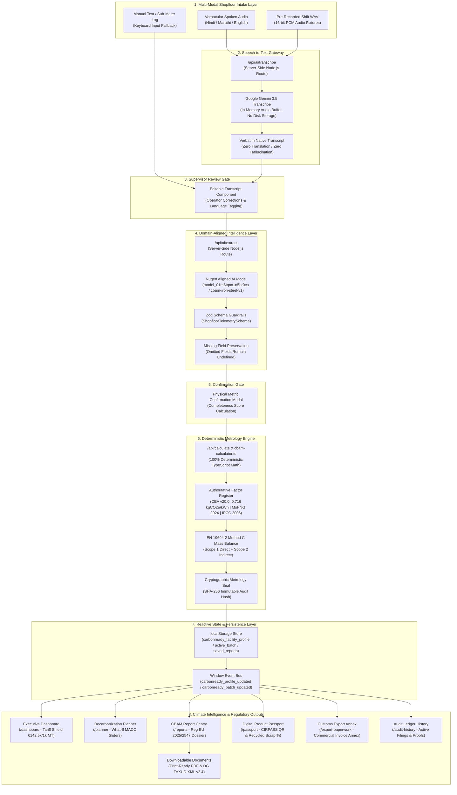
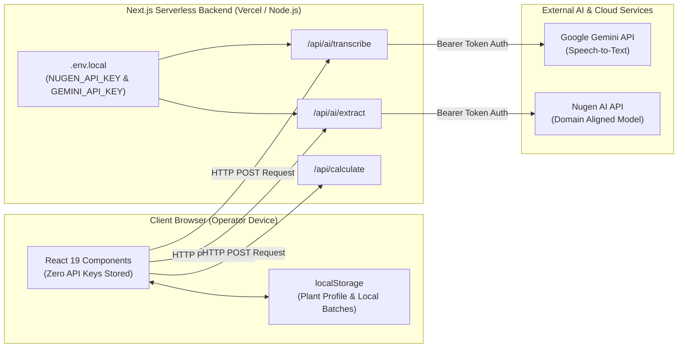

# CarbonReady — System Architecture & Technical Specification

**Project:** CARBONREADY — AI Carbon Compliance Copilot for MSME Exporters  
**Framework:** Next.js 15.5.29 (App Router) | React 19.0.0 | TypeScript v5.7.3  
**Target Scenario:** Indian Iron & Steel MSME Mini-Mills exporting to the European Union under EU CBAM (Regulations 2023/1773 & 2025/2547)

---

## 1. Architectural Overview & System Flow

CarbonReady implements a strict multi-tier architecture separating **Audio Metrology**, **Domain AI Entity Extraction**, **Deterministic Mathematical Calculations**, and **Regulatory Reporting**.



---

## 2. Component Architecture Breakdown

### 2.1 Audio Ingestion & Verbatim Transcription
- **Endpoint:** `src/app/api/ai/transcribe/route.ts`
- **Adapter:** `src/lib/ai/gemini-transcribe.ts`
- **Model:** `gemini-3.5-transcribe` (Google GenAI REST API) with fallback to `gemini-3.8-flash`.
- **Supported Codecs:** WAV (PCM), WebM (Opus), MP3, OGG, M4A, FLAC up to 20 MB.
- **Stateless Execution:** Audio is streamed into memory via Node.js `Buffer`. No media is written to the local disk, guaranteeing full compatibility with stateless serverless runtimes (e.g., Vercel, AWS Lambda).
- **Prompt Engineering:** Strict system instructions mandate faithful, word-for-word transcript generation in Devanagari Hindi (`hi-IN`), Devanagari Marathi (`mr-IN`), or Indian English (`en-IN`) without translation, summarization, or numerical extrapolation.

### 2.2 Domain AI Entity Extraction
- **Endpoint:** `src/app/api/ai/extract/route.ts`
- **Client Module:** `src/lib/ai/nugen-client.ts`
- **Model:** `model_01m6tqnx1n5br0ca` (`cbam-iron-steel-v1` on Nugen AI Cloud).
- **Schema Validation:** Enforces strict Zod schema parsing (`ShopfloorTelemetrySchema`).
- **Entity Coverage:** Heats count, raw scrap charged (MT), direct reduced iron / sponge iron (MT), sub-metered electricity (kWh), metallurgical coke consumed (MT), reheat furnace natural gas (Nm³), graphite electrode wear (kg/MT).
- **Zero-Hallucination Isolation:** Fields omitted in the spoken log remain `undefined`. The system calculates an explicit **Data Completeness Score (0–100%)** and alerts the operator.

### 2.3 Deterministic Carbon Calculation Engine
- **Engine Core:** `src/lib/engine/cbam-calculator.ts`
- **Factor Register:** `src/lib/engine/emission-factors.ts`
- **Methodological Standard:** **EN 19694-2:2016 Method C** (Stationary source emissions — Determination of GHG emissions in energy-intensive industries — Iron and steel industry).
- **Factor Traceability:**
  - **Scope 1 Direct (Combustion & Process):** Metallurgical coke (3.10 kgCO2e/kg per IPCC 2006 IPPU), Natural Gas reheat (2.69 kgCO2e/Nm³ per MoPNG 2024), Graphite electrodes (3.30 kgCO2e/kg per World Steel Association).
  - **Scope 2 Indirect (Electricity):** Central Electricity Authority (CEA) CO2 Baseline Database for the Indian Power Sector, Version 20.0 weighted average factor (**0.716 kgCO2e/kWh**).
  - **Scope 3 Precursors:** Purchased sponge iron DRI modeled at Indian national weighted average (1.75 tCO2e/MT per CEA/JPC). Post-consumer scrap carries 0.00 tCO2e embedded under CBAM Annex III §2.1.
- **Cryptographic Audit Seal:** Generates a deterministic SHA-256 hash sealing input activity data, calculation timestamps, and assigned emission factor versions.

### 2.4 State Synchronization & Client Storage
- **Storage Layer:** `src/lib/data/initial-plant-data.ts`
- **Client Storage Keys:**
  - `carbonready_facility_profile`: Plant identity, UDYAM registration, UN/LOCODE, target EU ports.
  - `carbonready_active_batch`: Latest verified shopfloor activity batch log.
  - `carbonready_saved_reports`: Chronological list of generated draft CBAM dossiers.
- **Reactive Event Bus:** Window custom events (`carbonready_profile_updated`, `carbonready_batch_updated`) notify subscriber components across views without requiring heavy external state managers.

### 2.5 Document & Report Generation
- **Report Centre:** `src/app/reports/page.tsx`
- **Print Engine:** CSS `@media print` rules in `src/app/globals.css` format high-contrast, multi-page, customs-ready A4 PDF documents.
- **XML Schema:** Machine-readable XML exporter matching the European Commission DG TAXUD CBAM Transitional / Definitive schema specifications (v2.4).

---

## 3. Directory Structure

```text
stitch_carbonready_msme_climate_intelligence_copilot/
├── public/
│   ├── audio/samples/           # 16-bit mono 16kHz PCM audio test fixtures (HI/MR/EN)
│   └── icons/                   # Material symbols & application icons
├── src/
│   ├── app/                     # Next.js 15 App Router pages & server routes
│   │   ├── api/ai/extract/      # Server Route Handler for Nugen aligned AI
│   │   ├── api/ai/transcribe/   # Server Route Handler for Gemini 3.5 Transcribe
│   │   ├── api/calculate/       # Server Route Handler for CBAM carbon engine
│   │   ├── assistant/           # Multilingual Voice Assistant & shift log intake
│   │   ├── audit-history/       # Consignment ledger with SHA-256 audit proofs
│   │   ├── benchmarks/          # Regional cluster benchmarking (Ludhiana/Jalna)
│   │   ├── calc-engine/         # Carbon Intelligence & metallurgical anomalies
│   │   ├── compliance/          # Multi-regulation matrix & CCTS tracker
│   │   ├── dashboard/           # Executive command dashboard & tariff shields
│   │   ├── export-paperwork/    # Customs Annex & Commercial Invoice auto-fill
│   │   ├── group-buying/        # Scrap & solar open-access consortium buying
│   │   ├── onboarding/          # Manufacturer plant profile & UDYAM registration
│   │   ├── passport/            # CIRPASS Digital Product Passport & Trust Badge
│   │   ├── planner/             # Decarbonization What-If MACC simulator
│   │   ├── reports/             # CBAM Report Centre (PDF & XML dossier generation)
│   │   ├── schemes/             # Indian government subsidies & grant matcher
│   │   ├── suppliers/           # Upstream Scope 3 precursor supplier portal
│   │   ├── verification/        # Accredited auditor marketplace (TÜV, DNV, BV)
│   │   ├── globals.css          # Tailwind CSS with @media print & reduced-motion rules
│   │   ├── layout.tsx           # Global root layout with theme provider
│   │   └── page.tsx             # Executive landing page
│   ├── components/              # Modular UI components
│   │   ├── shell/               # AppShell, SidebarNavigation, TopComplianceBar
│   │   └── ui/                  # AnimatedCounter, Badge, StatCard
│   ├── lib/                     # Core business logic & SDK adapters
│   │   ├── ai/                  # Nugen client, Gemini transcriber, prompt templates
│   │   ├── data/                # Initial plant profiles, demo state, storage helpers
│   │   └── engine/              # CBAM calculator, emission factors, CEA baselines
│   ├── test/                    # Vitest automated test suites (49 passing tests)
│   └── types/                   # TypeScript schemas for plant data & emissions
├── scripts/
│   ├── generate-sample-audio.js # Node.js script generating clean PCM WAV fixtures
│   └── run-next.js              # Platform-conditional Next.js launcher (Windows/Linux)
├── supabase/migrations/         # Optional PostgreSQL DDL schemas with RLS
├── .env.example                 # Safe environment configuration template
├── .gitignore                   # Comprehensive Git exclusion rules
├── next.config.ts               # Next.js build configuration with platform optimizations
├── package.json                 # Project dependencies and script definitions
├── tailwind.config.ts           # Stitch dark industrial enterprise styling tokens
└── tsconfig.json                # TypeScript compiler configuration
```

---

## 4. Security & Credential Boundary Model



1. **Server-Side Shielding:** Client browsers interact exclusively with local Next.js Route Handlers. Private API credentials (`NUGEN_API_KEY`, `GEMINI_API_KEY`) are kept on the server and are never delivered to client bundles.
2. **Untracked Environment:** Real credentials reside solely in `.env.local`, which is strictly ignored by `.gitignore`.
3. **Stateless Audio Processing:** Uploaded audio buffers are processed in volatile memory and destroyed upon stream completion.

---

## 5. Scope & External System Status

| Component | Architecture Status | Real vs Placeholder |
| :--- | :--- | :--- |
| **Speech-to-Text** | Production Ready | **Real Gemini 3.5 Transcribe** integration |
| **Domain AI Extraction** | Production Ready | **Real Deployed Nugen Aligned Model** (`model_01m6tqnx1n5br0ca`) |
| **Carbon Calculation Engine**| Production Ready | **Real Deterministic Math** (EN 19694-2 Method C, CEA v20.0) |
| **PDF & XML Export** | Production Ready | **Real Client-Side Document Generation** |
| **Digital Product Passport** | Production Ready | **Real CIRPASS-Aligned JSON-LD & QR Code** |
| **WhatsApp Chatbot** | **Excluded** | Deliberately excluded per competition architecture |
| **Accredited Verification** | Prototype Interface | Connects with representative profiles; Article 8 physical audit remains an external prerequisite |
| **Upstream Supplier Portal** | Prototype Interface | Demonstrates Scope 3 primary data requests |
| **Cloud PostgreSQL Sync** | Optional (Phase II) | DDL migrations prepared in `supabase/migrations/`; defaults to high-fidelity client storage |

---

## 9. Related Documentation & Repository Navigation

- 📋 [**Main Repository README (`../README.md`)**](../README.md)
- 📊 [**Feature Implementation & Verification Status (`PROJECT_STATUS.md`)**](PROJECT_STATUS.md)
- 🤝 [**Contributing Guide (`../CONTRIBUTING.md`)**](../CONTRIBUTING.md)
- 🔒 [**Security Policy (`../SECURITY.md`)**](../SECURITY.md)


